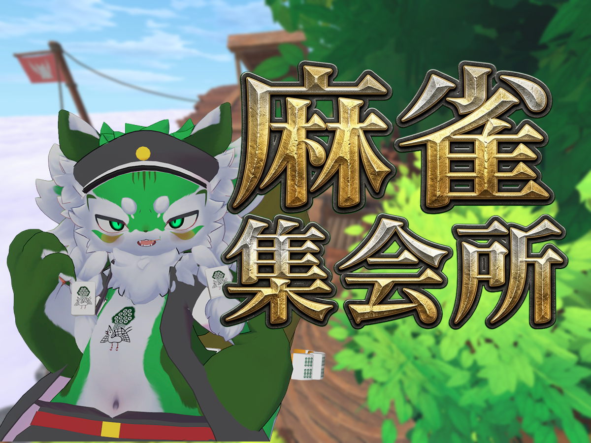
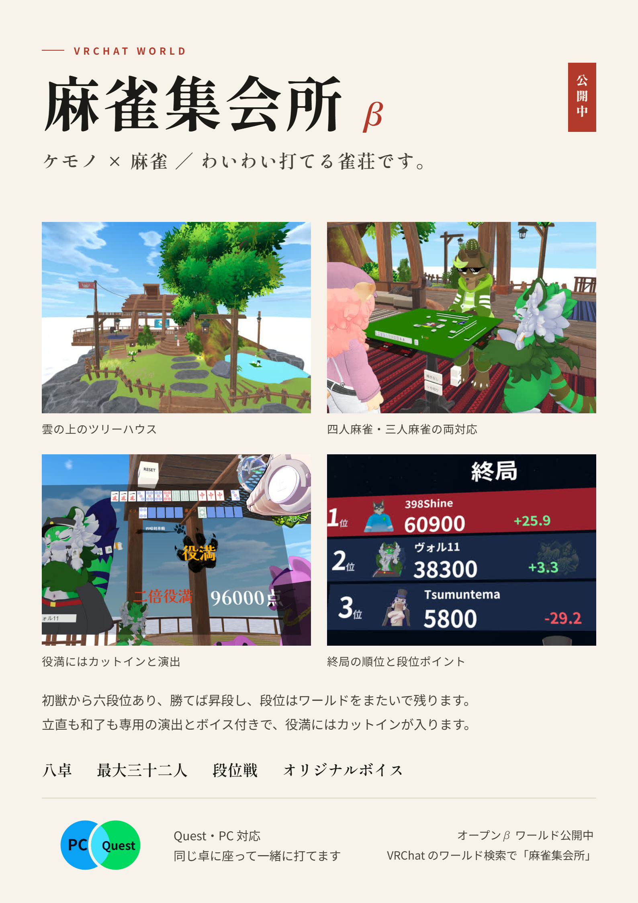

# 超能力ケモノ麻雀 — VRChat 多人数麻雀ワールド

> 🎬 **プレイ動画**：（ここに YouTube 等のリンク）
> 📄 **企画・仕様のポートフォリオ資料（PDF）**：（ここにリンク）
> 🌐 **ワールド**：「麻雀集会所 β」VRChat にてパブリック公開中（PC / Quest 対応・8卓・最大50人）

## ひとことで

**「雀魂の段位戦を、VRChat で友達と卓を囲んで遊べる場所」** を作りました。
企画・ゲーム仕様・優先順位の判断・実機テスト・運用は本人が担当し、実装は AI エージェント（Claude Code）に任せています。
本人はコードを書いておらず、IDE も使っていません。

主に毎週土曜 22:00〜24:00 に VRChat グループ「雀KEMO!!」で定期イベントを開催しています。

## なぜ作ったか

<!-- TODO: 本人の言葉で2〜3行。例：VRChat の既存の麻雀ワールドは「打てる」が「続ける理由」が無い。段位という目標と、集まる理由（イベント・観戦）を足したかった、など -->

## 企画の柱

| 柱 | 狙い | 具体的な仕組み |
|---|---|---|
| **続ける理由** | 1局で終わらず、また来たくなる | 雀魂準拠の段位戦（昇段・降段・天獣の天珠）、戦績・プロフィール分析、デイリーランキング |
| **すぐ遊べる** | 人を集める手間をゼロにする | ボタン1つで段位戦の待機列へ／フリー対局は部屋を作って誘う／空席は CPU が埋める |
| **見ても楽しい** | 打っていない人も場に残る | Mリーグ式の観戦中継モニター、役満のワールド全体告知、派手な和了・役満演出 |
| **ケモノと超能力** | 他の麻雀ワールドとの差別化 | キャラクター選択（Vol / Shine / Tsumuntema ＋自分のアバター）、超能力は現在設計を見直し中 |
| **公平さ** | 課金で強くならない | 収益化は見た目のエフェクト販売のみ（Pay-to-Win にしない） |

## 仕様を決めるときに考えたこと（例）

設計判断の一部です。詳しくはポートフォリオ資料にまとめています。

- **東風戦を足すとき、待機列を混ぜなかった**
  三麻／四麻 × 半荘／東風 の4本に完全に分けました。混ぜると早くマッチするが、「半荘のつもりが東風だった」という不満が出るためです。
  順位点は東風を半荘の半分にし、段位は共通にして戦績も合算しています。
- **途中退出には罰を、残された人には救済を**
  抜けた席は CPU が代打ちして対局を続行し、抜けた人には段位ポイントのペナルティをかけます。残った3人の対局を壊さないことを優先しました。
- **超能力の原則**
  発動は必ず全員に公開する、有利は自分だけに働く、全キャラを同等の強さにする。麻雀の駆け引きを壊さないための線引きです。
  牌山を操作する・牌を増減させる能力は、同期とチートの観点から避けています。
- **雀魂を知っている人が迷わないこと**
  ルール・点数表記・演出の順番（宣言ボイス → 手牌公開 → 牌の演出 → あがり画面）を雀魂に合わせています。
  一方で VR 特有の問題（ボタンの押し間違い、背の低いアバターで卓が見えない）には独自の対策を入れています。

## 実機テストと改善のサイクル

本人が PC / Quest / VR の実機とイベント参加者からの報告で不具合を見つけ、AI に原因調査と修正を指示し、実機で直ったことを確かめて公開する、という流れで回しています。

改善の例：
- **「終局したはずの卓が CPU だけで勝手に始まる」**（公開中のワールドでの報告）
  → 近くに人がいない卓を省電力で止める仕組みと、卓の進行役の引き継ぎがぶつかっていたことが原因。進行役を引き継ぐ条件を見直して解消。
- **「VR だとボタンを押し間違える」**
  → カンとポンのボタンの配置を離し、押した直後の誤操作を防ぐ待ち時間を設定で選べるように。
- **「北抜きボタンを押すと固まる」**（アルファ版での報告）
  → ボタンの割り当てが卓ごとに食い違っていたのを修正。

<!-- TODO: イベントの参加人数・開催回数・遊ばれた局数など、数字があれば足す -->

## AI との開発の進め方

- 仕様・確定事項・過去の失敗をドキュメントにまとめ、AI が毎回それを読んでから作業するようにしています（同じ失敗を繰り返させないため）。
- 1つの変更を1つの単位に区切って依頼し、実機で確認してから取り込みます。
- 「確定」と「要テスト」を区別して管理し、テストが済むまでは完成扱いにしません。

## 開発の分担

| 本人 | AI（Claude Code） |
|---|---|
| 企画・ゲーム仕様の決定（ルール、段位制度、演出の段取りなど） | コードの実装・修正 |
| 優先順位とスコープの判断、仕様の取捨選択 | Unity Editor の操作 |
| 実機（PC / Quest / VR）でのテストと不具合の報告 | 不具合のコード上の原因調査 |
| 開発ルールや知見の文書化、AI への指示の設計 | 作業を自動化する Editor ツールの作成 |
| ワールドの公開・運用・イベント開催 | |

<!-- TODO: 表の分担が実態と合っているか確認する -->

## このリポジトリに入っているもの

本プロジェクトで新規に作ったコード（青空麻雀に由来しないもの）を、規模の参考として収録しています。

- `Runtime/`：ワールド内で動くスクリプト 54 ファイル（約4.2万行）
- `Editor/`：制作を自動化する Unity Editor 拡張 76 ファイル（約4.7万行）

| 機能 | 主なファイル |
|---|---|
| 段位戦マッチング・フリー対局 | `Runtime/MatchmakingManager.cs`, `Runtime/MainMenuController.cs` |
| 段位・戦績・ランキング | `Runtime/PlayerStatsStore.cs`, `Runtime/InstanceRankingBoard.cs` |
| 観戦中継モニター | `Runtime/SpectatorMonitor.cs` |
| 和了・役満・鳴きの演出 | `Runtime/MahjongAgariEffect.cs`, `Runtime/MahjongYakumanCutin.cs`, `Runtime/MahjongCallEffect.cs` |
| VR で牌を掴んで打牌 | `Runtime/MahjongTileGrab.cs` |
| 5言語対応（日・英・韓・中簡・中繁） | `Editor/BuildLanguage.cs`, `Editor/KoreanText.cs`, `Editor/ChineseText.cs` |

### 注意事項

- 麻雀の進行ロジック本体は市販アセット「青空麻雀」（スズ製作所）を改造したものです。利用規約により改造版も再配布できないため、**同梱していません**。そのため本リポジトリ単体では動作しません。
- アート・サウンド等の購入アセットも同梱していません。
- スタッフの表示名などの個人情報は `<STAFF_NAME_1>` のような伏せ字に置き換えています。

## 技術的な前提（参考）

Unity 2022.3 / VRChat SDK3 Worlds / UdonSharp。PC と Meta Quest の両対応で、性能は Quest を基準にしています。
専用サーバーが無いため、操作はすべて「プレイヤーが要求 → 卓の進行役が検証 → 全員へ反映」の流れに統一しています。

## 権利表記

- 本リポジトリの内容：© 2026 <!-- TODO: 名前 -->. All rights reserved.（閲覧目的での公開です）
- 麻雀ロジック本体「青空麻雀」の著作権はスズ製作所に帰属します（本リポジトリには含みません）
